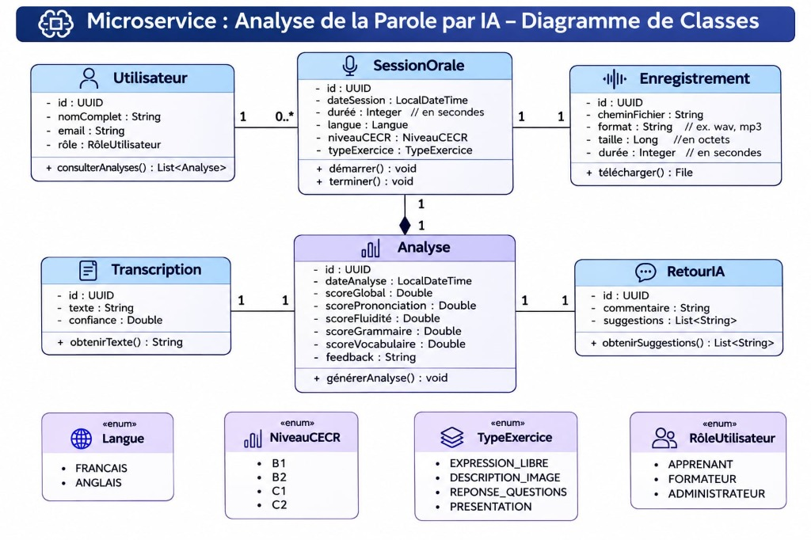
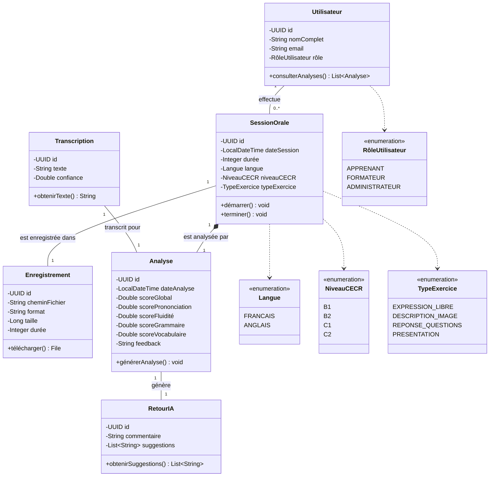

# Diagramme de classes : Analyse de la Parole par IA

Microservice **AI Speech Analysis** (Analyse de la Parole par IA) du projet **SpeakUp**. Il prend en charge la gestion des sessions d'expression orale, le traitement des enregistrements audio, la transcription automatique par IA, ainsi que l'évaluation multidimensionnelle (prononciation, fluidité, grammaire, vocabulaire) avec suggestions d'amélioration.

---

## Aperçu Visuel

---

## Diagramme Mermaid

---

## Description des classes

| Classe / Entité | Description & Responsabilités |
|---|---|
| `Utilisateur` | Représente l'acteur interagissant avec le système (apprenant, formateur ou administrateur). Il peut initier des sessions orales et consulter ses rapports d'analyse. |
| `SessionOrale` | Encadre la session de pratique orale avec sa date, sa durée, la langue cible, le niveau CECR visé et le type d'exercice pratiqué. Elle pilote le cycle de vie de la séance (`démarrer()`, `terminer()`). |
| `Enregistrement` | Métadonnées et gestion du fichier audio brut capturé lors de la session (chemin, format, taille en octets, durée). Permet le téléchargement du fichier source. |
| `Analyse` | Cœur analytique du microservice. Centralise l'évaluation globale et les scores détaillés par dimension (prononciation, fluidité, grammaire, vocabulaire), ainsi qu'un feedback textuel synthétique. |
| `Transcription` | Résultat de la conversion parole-en-texte (Speech-to-Text), incluant le texte brut retranscrit et l'indice de confiance du modèle IA. |
| `RetourIA` | Recommandations qualitatives formulées par l'IA : commentaires personnalisés et liste de suggestions concrètes d'amélioration. |

---

## Énumérations

- **`Langue`** : `FRANCAIS`, `ANGLAIS`.
- **`NiveauCECR`** : `B1`, `B2`, `C1`, `C2` (Cadre Européen Commun de Référence pour les Langues).
- **`TypeExercice`** : `EXPRESSION_LIBRE`, `DESCRIPTION_IMAGE`, `REPONSE_QUESTIONS`, `PRESENTATION`.
- **`RôleUtilisateur`** : `APPRENANT`, `FORMATEUR`, `ADMINISTRATEUR`.

---

## Choix de conception & Relations SOA

1. **Composition forte entre `SessionOrale` et `Analyse`** : Une session orale est liée de manière intrinsèque à son analyse (`1` $\leftrightarrow$ `1`). Si une session est supprimée ou invalidée, son analyse associée n'a plus de raison d'exister de façon isolée.
2. **Découplage de la `Transcription` et du `RetourIA`** : La transcription (pipeline STT) et le retour IA (pipeline LLM / NLP) sont isolés sous forme d'entités distinctes associées à `Analyse`. Cela permet d'interchanger ou de faire évoluer les modèles d'IA sans impacter la structure globale de l'évaluation.
3. **Séparation de l'`Enregistrement`** : Le fichier audio est traité comme une ressource dédiée avec ses propres métadonnées techniques (taille, format, stockage objet ou système de fichiers), ce qui optimise la gestion du stockage volumineux indépendamment des métadonnées de la session.
