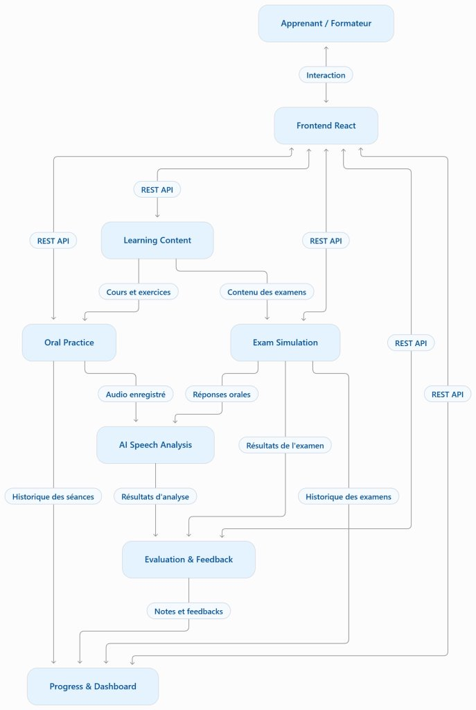
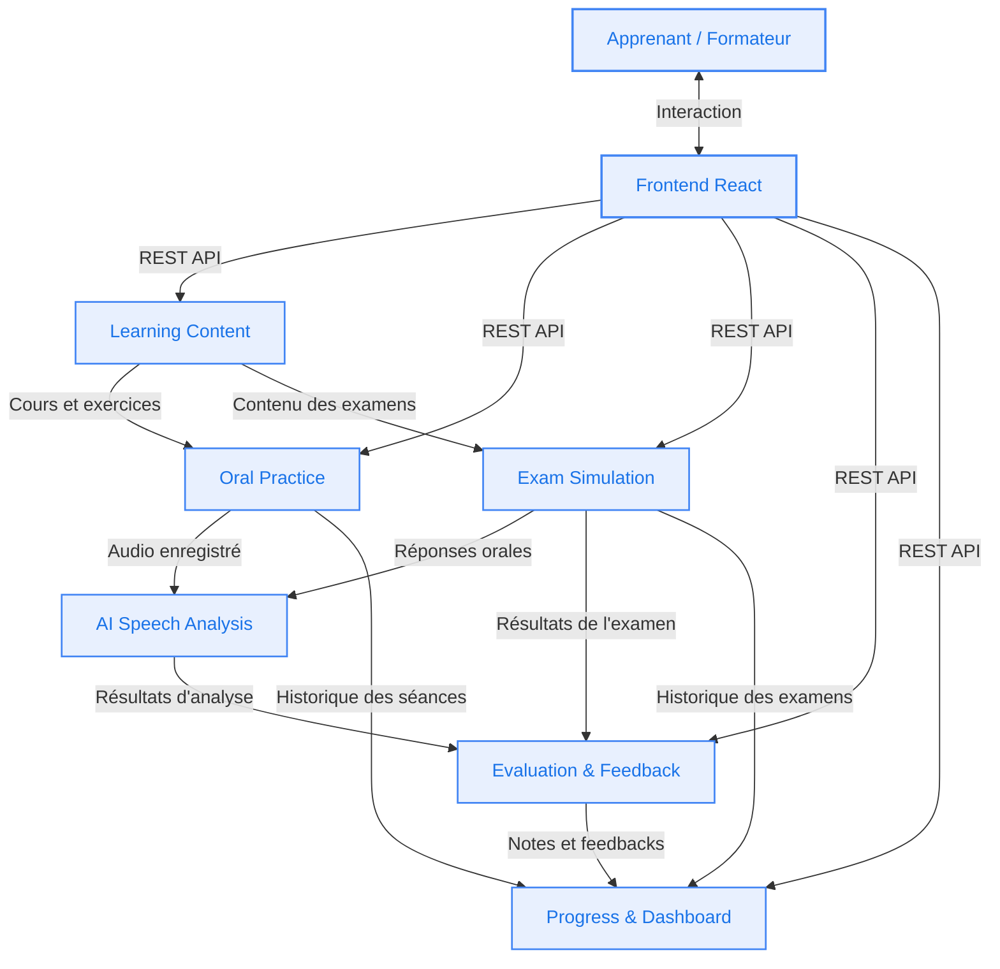

# Communication Diagram - SpeakUP Architecture

This document presents the global communication diagram and data flows between users, the Frontend interface, and the microservices of the **SpeakUP** platform.

---

## Visual Overview

---

## Mermaid Diagram

---

## Flow Description

| Source | Destination | Flow / Description | Type |
|---|---|---|---|
| Apprenant / Formateur | Frontend React | Interaction utilisateur | UI |
| Frontend React | Learning Content, Oral Practice, Exam Simulation, Evaluation & Feedback, Progress & Dashboard | Requêtes d'affichage et d'actions | REST API |
| Learning Content | Oral Practice | Cours et exercices | Métier / Données |
| Learning Content | Exam Simulation | Contenu des examens | Métier / Données |
| Oral Practice | AI Speech Analysis | Audio enregistré | Flux Audio |
| Oral Practice | Progress & Dashboard | Historique des séances | Événement / Données |
| Exam Simulation | AI Speech Analysis | Réponses orales | Flux Audio |
| Exam Simulation | Evaluation & Feedback | Résultats de l'examen | Données d'examen |
| Exam Simulation | Progress & Dashboard | Historique des examens | Événement / Données |
| AI Speech Analysis | Evaluation & Feedback | Résultats d'analyse | Données d'analyse |
| Evaluation & Feedback | Progress & Dashboard | Notes et feedbacks | Métriques de progression |
