# Diagramme de Classes Global - Plateforme SpeakUP

Ce document synthétise l'ensemble des diagrammes de classes des **6 microservices** de la plateforme **SpeakUP** au sein d'un diagramme de classes global unifié. 

Dans cette architecture orientée services (SOA), chaque microservice gère son propre modèle de données, et les liaisons inter-services s'effectuent par référence d'identifiants (IDs logiques) ou par échange d'événements/API REST.

---

## 1. Vue d'Ensemble par Microservice

1. **Learning Content** : Gestion des cours, leçons, contenus pédagogiques et exercices (QCM, expression orale).
2. **Oral Practice** : Gestion des sessions d'entraînement libre et des enregistrements de réponses orales.
3. **Exam Simulation** : Orchestration des simulations d'examens officiels (CECRL), parties d'épreuves, questions et réponses.
4. **AI Speech Analysis** : Transcription automatique (STT), analyse acoustique et linguistique (prononciation, fluidité, grammaire).
5. **Evaluation & Feedback** : Calcul et stockage des évaluations, critères de notation, détection d'erreurs et recommandations.
6. **Progress & Dashboard** : Consolidation des historiques, calcul de progression vers le niveau cible, objectifs et tableaux de bord formateur.

---

## 2. Diagramme de Classes Global (Mermaid)

```mermaid
classDiagram
direction TB

%% ====================================================
%% MICROSERVICE : LEARNING CONTENT
%% ====================================================
namespace Learning_Content {
    class UtilisateurLC {
        +UUID id
        +String nomComplet
        +String email
        +RoleUtilisateur role
        +consulterProgression()
    }

    class Inscription {
        +UUID id
        +LocalDateTime dateInscription
        +Double progression
        +StatutInscription statut
        +mettreAJourProgression(Double p)
        +terminer()
    }

    class Cours {
        +UUID id
        +String titre
        +String description
        +NiveauCECRL niveauCECRL
        +Langue langue
        +Integer duree
        +Boolean estPublie
        +ajouterLecon(Lecon l)
        +supprimerLecon(UUID id)
        +listerLecons()
    }

    class Lecon {
        +UUID id
        +String titre
        +Integer ordre
        +String description
        +ajouterContenu(Contenu c)
        +listerContenus()
    }

    class Contenu {
        +UUID id
        +String titre
        +TypeContenu type
        +String url
        +Integer duree
        +Integer ordre
        +lire()
        +getType()
    }

    class Exercice {
        +UUID id
        +String question
        +TypeExercice type
        +Integer points
        +verifierReponse(String r)
    }

    class ExerciceChoixMultiple {
        +List~String~ options
        +Integer indiceBonneReponse
        +verifierReponse(String r)
    }

    class ExerciceOralLC {
        +String texteAttendu
        +Double tolerance
        +evaluer(String audioUrl)
    }
}

%% Relations internes Learning Content
UtilisateurLC "1" -- "0..*" Inscription : effectue
Inscription "0..*" -- "1" Cours : concerne
Cours "1" *-- "1..*" Lecon : contient
Lecon "1" *-- "0..*" Contenu : compose
Contenu <|-- Exercice : heritage
Exercice <|-- ExerciceChoixMultiple : heritage
Exercice <|-- ExerciceOralLC : heritage


%% ====================================================
%% MICROSERVICE : ORAL PRACTICE
%% ====================================================
namespace Oral_Practice {
    class SessionPratique {
        +Long id
        +Long idApprenant
        +LocalDateTime dateDebut
        +LocalDateTime dateFin
        +StatutSession statut
        +demarrerSession()
        +terminerSession()
    }

    class ReponseOrale {
        +Long id
        +Long idExercice
        +String referenceAudio
        +LocalDateTime dateSoumission
        +soumettreReponse()
    }
}

%% Relations internes Oral Practice
SessionPratique "1" *-- "0..*" ReponseOrale : enregistre


%% ====================================================
%% MICROSERVICE : EXAM SIMULATION
%% ====================================================
namespace Exam_Simulation {
    class ExamSimulation {
        +Long id
        +Long learnerId
        +String title
        +String level
        +String status
        +LocalDateTime date
        +startExam()
        +finishExam()
        +cancelExam()
    }

    class ExamPart {
        +Long id
        +String type
        +String description
        +int duration
        +String status
    }

    class Question {
        +Long id
        +String content
    }

    class ResponseExam {
        +Long id
        +String content
        +String audioUrl
        +LocalDateTime submittedAt
    }
}

%% Relations internes Exam Simulation
ExamSimulation "1" *-- "1..*" ExamPart : compose
ExamPart "1" -- "0..*" Question : comporte
Question "1" -- "0..1" ResponseExam : recoit


%% ====================================================
%% MICROSERVICE : AI SPEECH ANALYSIS
%% ====================================================
namespace AI_Speech_Analysis {
    class SessionOraleAI {
        +UUID id
        +LocalDateTime dateSession
        +Integer duree
        +Langue langue
        +NiveauCECR niveauCECR
        +demarrer()
        +terminer()
    }

    class Enregistrement {
        +UUID id
        +String cheminFichier
        +String format
        +Long taille
        +Integer duree
        +telecharger()
    }

    class Transcription {
        +UUID id
        +String texte
        +Double confiance
        +obtenirTexte()
    }

    class Analyse {
        +UUID id
        +LocalDateTime dateAnalyse
        +Double scoreGlobal
        +Double scorePrononciation
        +Double scoreFluidite
        +Double scoreGrammaire
        +Double scoreVocabulaire
        +String feedback
        +genererAnalyse()
    }

    class RetourIA {
        +UUID id
        +String commentaire
        +List~String~ suggestions
        +obtenirSuggestions()
    }
}

%% Relations internes AI Speech Analysis
SessionOraleAI "1" *-- "1" Enregistrement : capture
Enregistrement "1" -- "1" Transcription : produit
Enregistrement "1" -- "1" Analyse : fait l'objet de
Analyse "1" *-- "0..*" RetourIA : detaille


%% ====================================================
%% MICROSERVICE : EVALUATION & FEEDBACK
%% ====================================================
namespace Evaluation_Feedback {
    class Evaluation {
        +Long id
        +Long recordingId
        +String learnerId
        +Language language
        +CecrlLevel targetLevel
        +CecrlLevel estimatedLevel
        +String transcription
        +Double globalScore
        +EvaluationStatus status
        +LocalDateTime createdAt
    }

    class CriterionScore {
        +Long id
        +CriterionType criterion
        +Double score
        +String comment
    }

    class LinguisticError {
        +Long id
        +ErrorType type
        +String originalText
        +String suggestedCorrection
        +String explanation
        +Integer startOffset
        +Integer endOffset
    }

    class Recommendation {
        +Long id
        +String title
        +String content
        +Integer priority
        +CriterionType targetCriterion
    }

    class TrainerReview {
        +Long id
        +String trainerId
        +Double adjustedScore
        +String comment
        +LocalDateTime reviewedAt
    }
}

%% Relations internes Evaluation & Feedback
Evaluation "1" *-- "1..*" CriterionScore : quantifie
Evaluation "1" *-- "0..*" LinguisticError : detecte
Evaluation "1" *-- "0..*" Recommendation : preconise
Evaluation "1" *-- "0..1" TrainerReview : validee par


%% ====================================================
%% MICROSERVICE : PROGRESS & DASHBOARD
%% ====================================================
namespace Progress_Dashboard {
    class GroupDashboard {
        +Long id
        +String trainerId
        +String groupName
        +Double groupAverageScore
        +int activeLearners
        +refresh()
    }

    class LearnerProgress {
        +Long id
        +String learnerId
        +CecrlLevel currentLevel
        +CecrlLevel targetLevel
        +double progressPercentage
        +double averageScore
        +int totalSessions
        +LocalDateTime lastActivityAt
        +addResult()
        +computeProgress()
    }

    class ProgressEntry {
        +Long id
        +Long evaluationId
        +ActivityType activityType
        +double globalScore
        +LocalDateTime recordedAt
    }

    class CriterionProgress {
        +Long id
        +CriterionType criterion
        +double averageScore
        +String trend
    }

    class Goal {
        +Long id
        +CecrlLevel targetLevel
        +LocalDate deadline
        +GoalStatus status
    }
}

%% Relations internes Progress & Dashboard
GroupDashboard "1" o-- "0..*" LearnerProgress : suit
LearnerProgress "1" *-- "0..*" ProgressEntry : archive
LearnerProgress "1" *-- "1..*" CriterionProgress : mesure
LearnerProgress "1" *-- "0..*" Goal : definit


%% ====================================================
%% RELATIONS INTER-SERVICES (Liaisons SOA / IDs logiques)
%% ====================================================
ReponseOrale ..> Exercice : idExercice (utilise)
ReponseOrale ..> Enregistrement : referenceAudio (analyse vocale)
ResponseExam ..> Enregistrement : audioUrl (analyse vocale)
Analyse ..> Evaluation : alimente scores & transcription
ResponseExam ..> Evaluation : declenche evaluation examen
Evaluation ..> ProgressEntry : evaluationId (consolide)
SessionPratique ..> LearnerProgress : idApprenant (maj historique)
ExamSimulation ..> LearnerProgress : learnerId (maj historique)
```

---

## 3. Matrice des Liaisons Inter-Services (SOA)

Dans une architecture distribuée, les microservices ne partagent pas leurs bases de données directes. Les entités sont corrélées via des identifiants métier :

| Entité Source | Microservice Source | Entité Cible | Microservice Cible | Clé / Mécanisme de corrélation |
|---|---|---|---|---|
| `ReponseOrale` | **Oral Practice** | `Exercice` | **Learning Content** | `idExercice` (récupère le sujet et la consigne) |
| `ReponseOrale` | **Oral Practice** | `Enregistrement` | **AI Speech Analysis** | `referenceAudio` / fichier audio envoyé pour analyse STT |
| `ResponseExam` | **Exam Simulation** | `Enregistrement` | **AI Speech Analysis** | `audioUrl` / enregistrement de l'épreuve orale |
| `Analyse` | **AI Speech Analysis** | `Evaluation` | **Evaluation & Feedback** | Transfert des scores de prononciation, fluidité et transcription |
| `ResponseExam` | **Exam Simulation** | `Evaluation` | **Evaluation & Feedback** | Déclenche l'évaluation globale d'une simulation |
| `Evaluation` | **Evaluation & Feedback** | `ProgressEntry` | **Progress & Dashboard** | `evaluationId` + `globalScore` archivés dans la progression |
| `SessionPratique` | **Oral Practice** | `LearnerProgress` | **Progress & Dashboard** | `idApprenant` pour incrémenter `totalSessions` |
| `ExamSimulation` | **Exam Simulation** | `LearnerProgress` | **Progress & Dashboard** | `learnerId` pour enregistrer l'activité d'examen |

---

## 4. Synthèse des Énumérations Clés du Système

- **NiveauCECRL** : `B1`, `B2`, `C1`, `C2`
- **Langue / Language** : `FR` (Français), `EN` (Anglais)
- **CriterionType** : `PRONUNCIATION`, `FLUENCY`, `INTONATION`, `VOCABULARY`, `GRAMMAR`, `COHERENCE`
- **ErrorType** : `GRAMMAR`, `VOCABULARY`, `SPELLING`
- **EvaluationStatus** : `PENDING`, `COMPLETED`, `VALIDATED`, `FAILED`
- **ActivityType** : `PRACTICE`, `EXAM_SIMULATION`
- **GoalStatus** : `IN_PROGRESS`, `ACHIEVED`, `EXPIRED`
- **StatutSession** : `EN_COURS`, `TERMINEE`, `ANNULEE`
