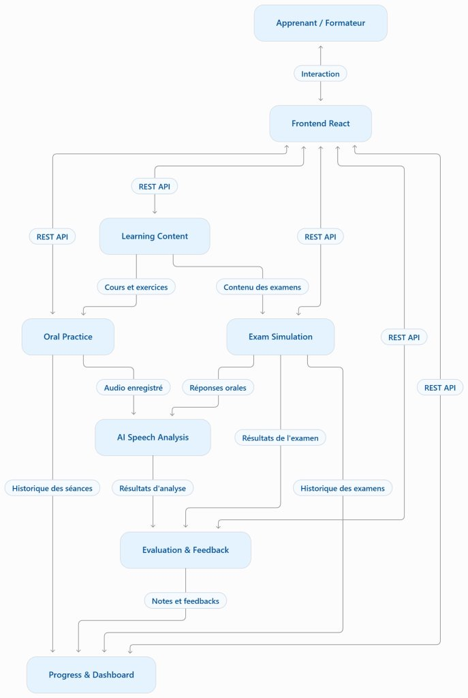
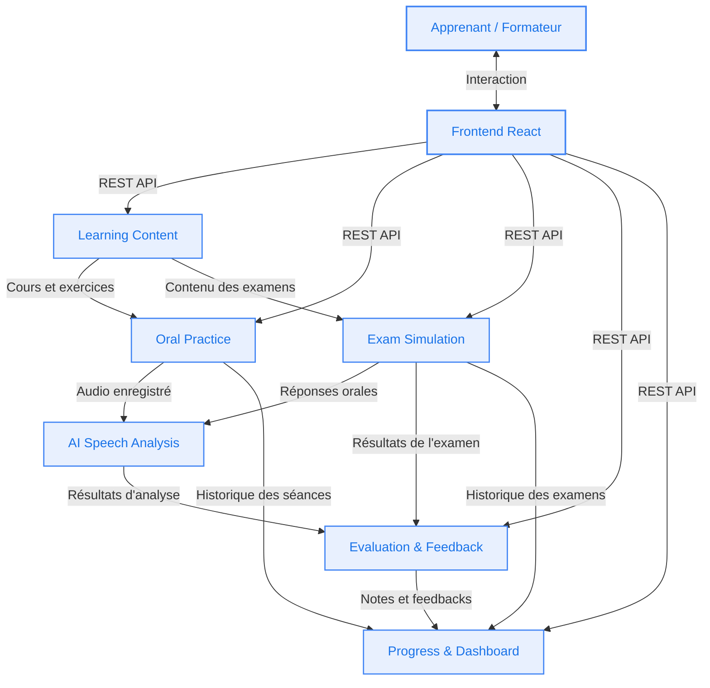

# Diagramme de Communication - Architecture SpeakUP

Ce document présente le diagramme de communication global et les flux d'échanges entre l'utilisateur, l'interface utilisateur (Frontend) et les différents microservices du projet **SpeakUP**.

---

## Aperçu Visuel

---

## Diagramme Mermaid

---

## Description des Composants et des Flux

### 1. Acteurs et Interface
- **Apprenant / Formateur** : Utilisateurs finaux qui interagissent avec l'application web pour s'entraîner, passer des examens oraux ou consulter les résultats.
- **Frontend React** : Point d'accès interactif permettant la saisie utilisateur, l'enregistrement vocal et la restitution visuelle des feedbacks et tableaux de bord. Communique via des API REST avec les microservices métier.

### 2. Microservices Métier
| Microservice | Rôle | Échanges Entrants | Échanges Sortants |
|---|---|---|---|
| **Learning Content** | Fournit les cours, thèmes d'entraînement et sujets d'examens. | `REST API` (Frontend) | `Cours et exercices` → Oral Practice `Contenu des examens` → Exam Simulation |
| **Oral Practice** | Gère les sessions libres et guidées d'expression orale. | `REST API` (Frontend) `Cours et exercices` (Learning Content) | `Audio enregistré` → AI Speech Analysis `Historique des séances` → Progress & Dashboard |
| **Exam Simulation** | Orchestre les simulations d'épreuves orales CECRL en temps limité. | `REST API` (Frontend) `Contenu des examens` (Learning Content) | `Réponses orales` → AI Speech Analysis `Résultats de l'examen` → Evaluation & Feedback `Historique des examens` → Progress & Dashboard |
| **AI Speech Analysis** | Réalise la transcription (STT) et l'analyse acoustique/linguistique (fluidité, prononciation, grammaire). | `Audio enregistré` (Oral Practice) `Réponses orales` (Exam Simulation) | `Résultats d'analyse` → Evaluation & Feedback |
| **Evaluation & Feedback** | Consolide les métriques d'analyse et génère les notations et recommandations pédagogiques. | `REST API` (Frontend) `Résultats d'analyse` (AI Speech Analysis) `Résultats de l'examen` (Exam Simulation) | `Notes et feedbacks` → Progress & Dashboard |
| **Progress & Dashboard** | Centralise et agrège les indicateurs de suivi et la progression de l'apprenant. | `REST API` (Frontend) `Historique des séances` (Oral Practice) `Notes et feedbacks` (Evaluation & Feedback) `Historique des examens` (Exam Simulation) | Restitution des tableaux de bord vers le Frontend via `REST API` |
