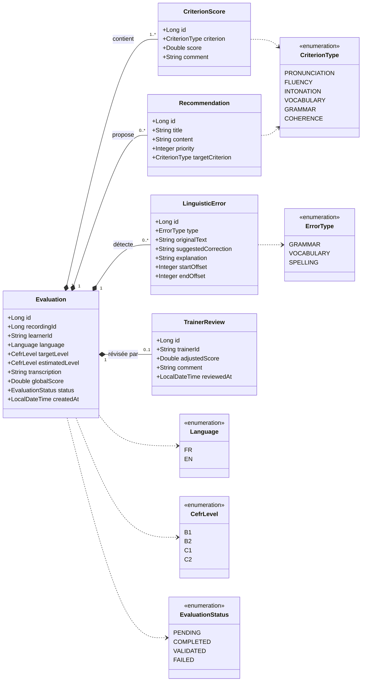

# Diagramme de classes : Evaluation & Feedback

Microservice **Evaluation & Feedback** du projet SpeakUp. Il stocke les scores, les corrections et les recommandations issus de l'analyse d'une prise de parole.

## Diagramme

## Description des classes

| Classe | Rôle |
|---|---|
| `Evaluation` | Une prise de parole analysée : transcription, note globale, niveau CECRL estimé et statut. |
| `CriterionScore` | Score et commentaire pour un critère (prononciation, fluidité, intonation, lexique, grammaire, cohérence). |
| `LinguisticError` | Erreur détectée dans la transcription, avec sa correction et sa position dans le texte. |
| `Recommendation` | Conseil personnalisé, lié à un critère et classé par priorité. |
| `TrainerReview` | Révision du formateur : note ajustée et commentaire. La note de l'IA est conservée. |

## Choix de conception

- `recordingId` et `learnerId` sont de simples identifiants : l'enregistrement appartient à un autre microservice et l'apprenant est géré par Keycloak. Il n'y a pas de clé étrangère entre services, chaque service ayant sa propre base de données.
- Les scores par critère sont dans une classe séparée pour pouvoir ajouter un critère sans modifier le schéma.
- La révision du formateur est distincte de l'évaluation : l'évaluation automatique est une aide, pas une décision définitive.